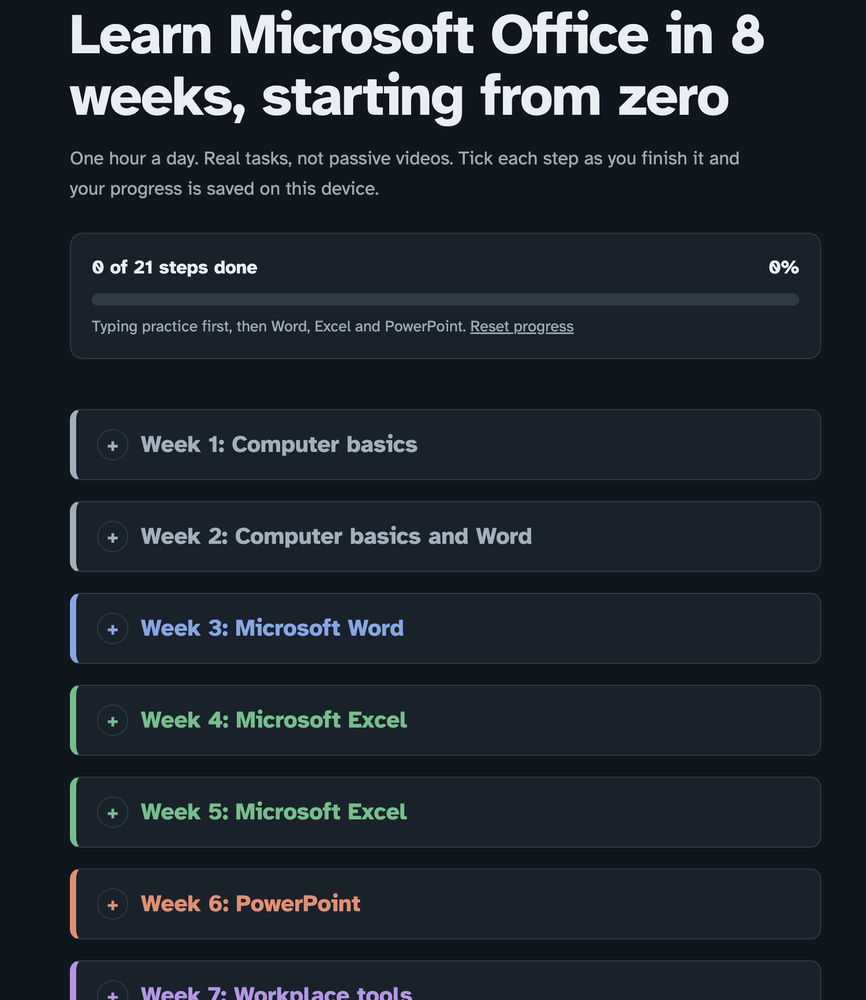

# Microsoft Office Learning Roadmap

**Live website:** [microsoft-office-roadmap.vercel.app](https://microsoft-office-roadmap.vercel.app/)

A free, beginner-friendly eight-week roadmap from Dabik Technologies for people starting from zero with computer and office skills. The plan moves from computer basics and typing to Microsoft Word, Excel, PowerPoint, and common workplace tools.

The roadmap is organized into eight collapsible weekly sections, from computer basics and typing through Microsoft Word, Excel, PowerPoint, and workplace tools. Each section contains practical steps, with projects to help apply new skills.

Visitors can check off completed steps, see their overall progress, and return later to find their progress saved in the same browser on the same device. A reset option clears saved progress, and a share button makes it easy to send the roadmap to someone else.

## Website Preview

